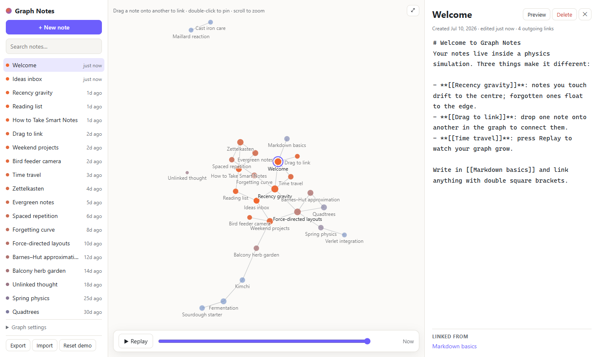
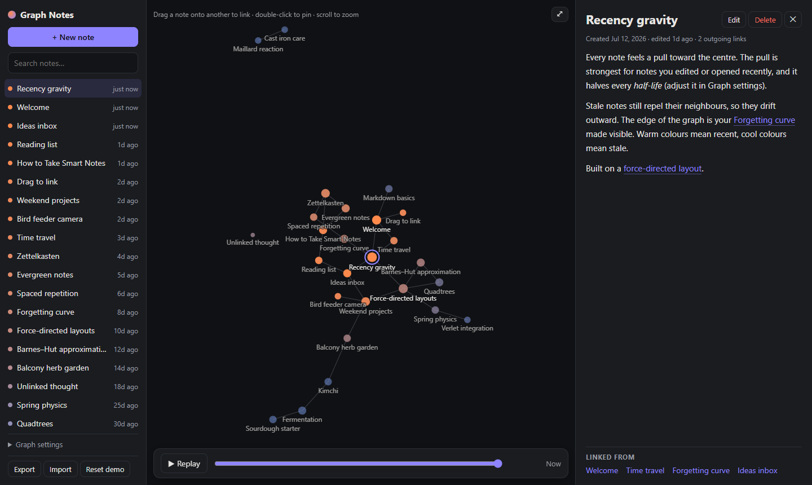
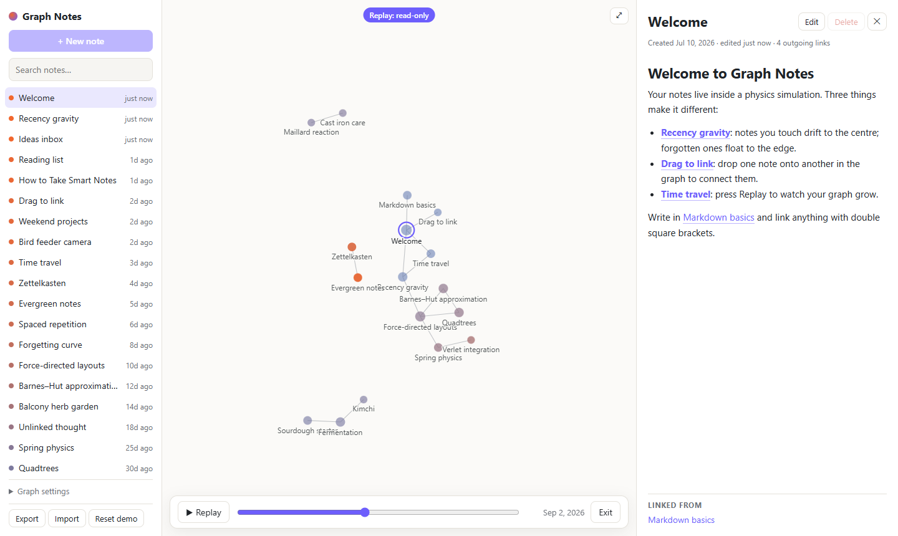
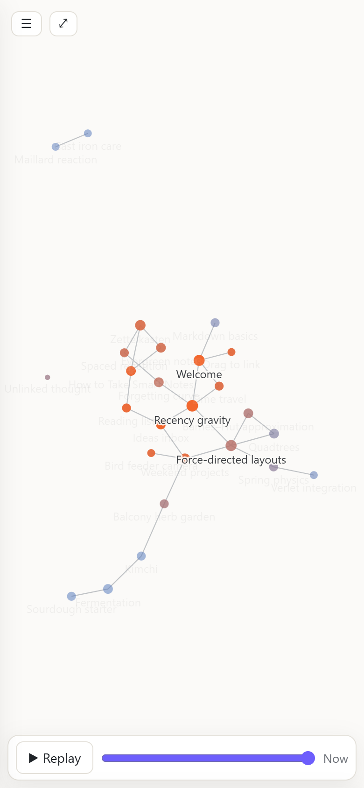

# Graph Notes

A note-taking app where your notes live inside a physics simulation.

- **Recency gravity**: notes you edit or open drift to the centre; untouched notes float to the edge. Warm colours mean recent, cool colours mean stale. The pull halves every *half-life* (Graph settings).
- **Drag to link**: drop one note onto another in the graph. A `Related: [[Target]]` line is added to the dragged note.
- **Time travel**: press **Replay** (or scrub the slider) to watch your graph grow. Notes appear on the day they were created; links appear when they were first written.

Plus: Markdown with `[[wikilinks]]` (`[[Title]]`, `[[Title#Heading]]`, `[[Title|alias]]`), `[[` autocomplete, backlinks, rename that rewrites links everywhere, pinning (double-click), search, JSON export/import, light/dark themes, and a mobile layout.

## What it looks like



The screen has three panes:

- **Left, the note list:** every note, most recently touched first. The coloured dot matches the note's colour in the graph. Below the list are search, **Graph settings** (recency gravity on/off, half-life, link distance, repel strength) and Export / Import / Reset demo.
- **Middle, the graph:** each note is a circle and each `[[wikilink]]` is a line. Bigger circles have more links. Warm orange notes were touched recently and sit near the centre, while cool blue ones haven't been opened in a while and drift to the edge. Notes with no links (like *Unlinked thought*) float on their own. The selected note has a ring around it. The **⤢** button fits the whole graph in view, and the timeline bar along the bottom runs the replay.
- **Right, the editor:** the note's title, when it was created and last edited, and how many links it makes. **Preview** / **Edit** switches between raw Markdown and the rendered note. **Linked from** at the bottom lists the backlinks.

The theme follows your system setting. Here's dark mode, with a note in preview and its four backlinks:



Drag the timeline slider, or press **Replay**, to see the graph as it was on an earlier date. Notes that didn't exist yet are hidden, and the rest are coloured by how new they were on that date. The camera follows the graph as it grows. Editing is turned off during a replay (note the *Replay: read-only* badge) until you press **Exit**.



On a phone the graph fills the screen. **☰** slides the note list in from the left, and opening a note slides the editor up from the bottom. When zoomed out, only the big hub notes keep their labels, and the rest fade in as you zoom.



## Run it

No dependencies. Node 20+:

```sh
node serve.mjs          # → http://localhost:5173
node --test test/       # 21 tests: physics engine, data model, markdown
```

It has to be served over http (module workers don't load from `file://`). Any static server works.

Notes are stored in your browser's `localStorage` (key `graph-notes:v1`). Use **Export** for backups. If stored data is ever unreadable it is copied to a backup key rather than overwritten.

## How it works

| File | Role |
| --- | --- |
| `js/sim-core.js` | Force-directed layout engine: link springs, Barnes–Hut many-body repulsion (quadtree, θ = 0.9), per-node gravity, grid-based collision, velocity damping. Pure, so it's testable in Node. |
| `js/sim-worker.js` | Runs the engine in a Web Worker at ~60 fps while warm; positions go back as transferred `Float32Array`s. |
| `js/graph-view.js` | Canvas renderer and interaction: pan, zoom, pinch, hover highlight, drag-to-link, pin. |
| `js/store.js` | Notes model, wikilink parsing, link first-seen timestamps, recency, persistence. |
| `js/markdown.js` | Small, escaping-first Markdown renderer (only `http(s)` links are emitted). |
| `js/main.js` | UI wiring: editor, autocomplete, backlinks, replay, settings. |

Recency gravity is just a per-node multiplier on the centring force: `g = 0.25 + 2.75 · 0.5^(age / half-life)`. Many-body repulsion does the rest, pushing low-gravity notes outward.

While you drag a note it becomes a "ghost" that doesn't repel or collide, so the note you're aiming at doesn't flee.

The architecture (physics in a worker, flat typed arrays, Barnes–Hut) mirrors what Obsidian's graph view does. This is an independent implementation in the style of d3-force; no Obsidian code is used.

## Ideas for v2

- Ghost links: suggest connections between related but unlinked notes using on-device embeddings
- Named "continents": community detection + soft cluster outlines
- Bridge prompts: suggest notes that would connect two clusters
- Port `sim-core` to WebAssembly for very large graphs
